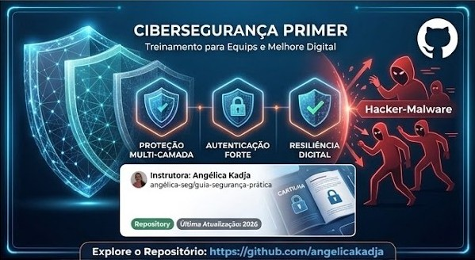

+a+cartilha+de+Cibersegurança!>)

 

 
<i>Imagem gerada pela Gemini!</i>

---

# Cartilha de Cibersegurança

Material de apoio para treinamentos corporativos: uma cartilha interativa e responsiva, em formato de livro, que reúne o essencial para reconhecer ameaças digitais e adotar hábitos seguros no dia a dia.

**[Acessar a cartilha](https://angelicakadja.github.io/cartilha-ciberseguranca/)**

## O que você vai encontrar

São 7 páginas, pensadas para leitura rápida no celular ou no computador:

1. **Capa**
2. **Tipos de malware:** vírus, worm, trojan, ransomware, spyware, adware, rootkit e botnet, além dos sinais de infecção.
3. **VPN:** o que é, o que não é, tipos (corporativa, site-to-site e pessoal) e protocolos confiáveis e ultrapassados.
4. **VPN gratuita, freemium e paga:** os riscos escondidos das gratuitas, por que as freemium tendem a ser mais seguras e como escolher um provedor.
5. **Engenharia social:** phishing, smishing, vishing, pretexting, baiting, quishing, golpe do falso chefe e deepfake.
6. **Hábitos de defesa:** senhas, autenticação em duas etapas, atualizações, backup 3-2-1, Wi-Fi público e fontes oficiais.
7. **Se algo der errado:** o que fazer, passo a passo, diante de um incidente.

## Como navegar

- Toque ou clique nas **laterais da página** para virar, como em um livro.
- No celular, **deslize** para o lado.
- No computador, use as **setas do teclado** ← e →.

## Para quem é

Para qualquer colaborador, de qualquer área, que queira entender os riscos digitais sem jargão técnico. O conteúdo é geral e pode ser usado em treinamentos de diferentes empresas.

## Tecnologia

Um único arquivo HTML, sem dependências para instalar, com layout responsivo e publicado via GitHub Pages.

## Autoria

Criado por **Angélica Kadja**.

- [Angélica Kadja - LinkedIn](https://www.linkedin.com/in/adm-angelicakadja)
- [Angélica Kadja - Blogger](https://sintesenuaecrua.blogspot.com/)

---

 
Feito com , até mais!

👧🏽 - ver mais em <a href="https://github.com/angelicakadja">AK</a>.
